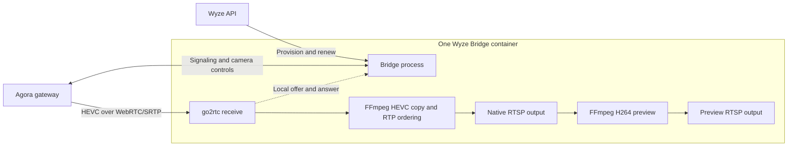

# Cam Pan v4: integrated receiver

This implementation uses the existing Bridge container and existing go2rtc and
FFmpeg executables. The Bridge process handles Wyze authentication and Agora
WebRTC gateway signaling. go2rtc receives standard WebRTC/SRTP. The existing go2rtc 1.9.14 source is
built with a dedicated 4096-packet SRTP receive window for this path; replay
protection remains enabled and other transports keep their default windows. FFmpeg copies the HEVC video through a bounded RTP reorder queue
before publishing native RTSP and deriving the H264 preview.

There is no Agora SDK, Python receiver, MediaMTX service, second container or
additional Go module or OS package. The existing gorilla/websocket module is
reused for signaling; encryption and HTTP use the Go standard library.

The normal Dockerfile builds Bridge and the patched go2rtc in one image.
Bridge's `go.mod` and `go.sum` are unchanged, and go2rtc retains the same
upstream dependency versions. No companion image is needed. External go2rtc
mode is not supported
for this receive path because it lacks the required receive window, templates
and owned-stream teardown.

## Stream flow



Both RTSP outputs are served by the same embedded go2rtc process. The receiver
is started on demand by a consumer; it is not a separate container or service.

## Camera outputs

A discovered `HL_PAN4` automatically gets two outputs:

| Output | Purpose |
| --- | --- |
| `rtsp://HOST:8554/<camera>` | H264 preview, 1920x1080 for HD; 640x360 for SD |
| `rtsp://HOST:8554/<camera>_4k` | Native HEVC camera video, without scaling/re-encoding |

The receiver requests the camera property `camera::resolution=2k`. On the tested
Pan v4 this property delivers 3840x2160. The camera can initially send 360p while
joining or changing quality. Verify actual decoded dimensions rather than
assuming that a quality value or stream name proves resolution.

Use the canonical camera URL or `_4k` URL, rather than the internal `_lake`
transport, so the RTP ordering stage applies. Native frame rate follows the
camera and its lighting conditions; the preview may resample for pacing.

HomeKit/Scrypted can retain the H264 preview URL; an HEVC-capable recorder can
use the native output. This does not add native 4K recording to Apple Home or
import recordings from the camera's SD card. Audio and PTZ are not implemented
by this initial receive path. Other camera models retain their existing routing.

## Session lifecycle and recovery

Both outputs share one internal `<camera>_lake` transport and one camera
gateway session. The `_4k` output copies HEVC through FFmpeg to restore RTP
ordering; it does not decode, scale or re-encode that native video. The reorder
queue is bounded to 4096 packets with a one-second maximum demuxing delay.
The H264 preview requests a keyframe every two seconds, including when the
camera reduces its frame rate in low light. This keeps playback/recording starts
responsive without imposing a different frame rate on the camera.
The internal transport is also removed on stop, reconnect, removal and rename.
The session starts when a consumer requests video. Its short local websocket
exchanges SDP with go2rtc; the Agora websocket remains alive after go2rtc closes
that initial signaling connection. Stopping the camera closes its gateway
session before tearing down preview,
native and internal transport streams. An opt-in go2rtc teardown closes their
retained and pending clients, preventing hidden encoders after reconnect. Exact
original-source checks protect operator streams, and ordinary stream deletion
keeps its existing behavior. Late offers cannot reopen a stopped camera.
Failed registration also cleans up partially stored outputs. Shutdown cancels
all owned sessions.

The receiver periodically sends camera ownership and quality controls. Tokens
renew in the existing channel. A failed renewal, lost gateway or stalled video
must recover through camera reconnection. The camera health check observes
received bytes, and distinguishes idle sources from missing registrations or
an active source that is no longer receiving data. The existing STREAMING badge
still indicates registration; validate arriving frames for actual playback.

A second camera session or the Wyze app can compete over quality. Test with a
spare camera or stop its existing receiver before opening another session. The
receiver still connects through Wyze/Agora cloud services.

Only loopback go2rtc requests can reach internal signaling. Browser-origin
requests are rejected. Account credentials and encryption keys do not appear
in stream URLs, SDP answers or errors. HTTPS/WSS certificate verification stays
enabled. Existing stream-access authentication settings still apply.

## Validation status

One Cam Pan v4 (`HL_PAN4`, firmware `4.70.6.4312`) was tested on an amd64
Synology NAS. An ordinary integrated image recorded more than 61 minutes of
native 3840x2160 HEVC (36,967 frames) and 1920x1080 H264 (74,162 frames).
Both complete files passed strict decoding with zero errors. Nine sampled
frames from each output, spread across the full recording, showed no gray bands
or damaged images. The preview resampled for pacing during that run; the native
video averaged approximately 10fps in low light.

A renewal request was sent at 40 minutes, and video continued beyond the
original requested one-hour token lifetime without a producer replacement.
That long run preceded the final lifecycle and configuration fixes. The final
image includes fresh-session startup grace, custom-YAML compatibility, late-offer
cancellation and explicit media teardown. On that final ordinary image,
one-minute native/preview recordings passed full-file strict decoding with zero
errors both after installation and after a Front-only reconnect. Nine sampled
frames from each output and phase were clean. The reconnect restored byte flow
in about 12 seconds, without replacing the other cameras' producers. Only one
preview encoder and one native-copy worker remained after reconnect.
Credentials, ports, mounted data and Scrypted settings/pairings were preserved.
Only one Wyze container was running; the previous receiver was stopped.

The receive-window change was checked with real local Pion peers: delayed
authenticated packets are accepted by the expanded window, duplicates are
still rejected, and ordinary clients retain their default behavior. A private
real-camera trace recovered delayed packets 277 positions behind with the
expanded window. An offline reordered-RTP check produced the same encoded
HEVC after buffering as the ordered input.

The full Bridge race suite and vet pass, alongside targeted real-engine
receive-window, replay and teardown tests. The ordinary amd64 image builds,
and Bridge plus the patched engine cross-compile for Linux arm64/armv7.
Runtime package versions and both projects' Go module files are unchanged.
ARM hardware, multiple simultaneous Pan v4 cameras, hosted CI and a 24-hour run have not been verified. A new Apple Home recorded
clip on the final image still needs a user playback check.

Offline checks:

```sh
go test -race ./...
go vet ./...
docker build -f docker/Dockerfile -t wyze-bridge:pan-v4-streaming .
```

Protocol research credits: Jezza34000/homeassistant_petkit (MIT),
alphabin/ClaudeWyze4Sln, and mitchross's earlier Pan v4 receiver design.
See THIRD_PARTY_NOTICES.md for preserved attribution.
