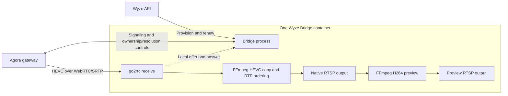

# Cam Pan v4: integrated receiver

This implementation uses the existing Bridge container and existing go2rtc and
FFmpeg executables. The Bridge process handles Wyze authentication and Agora
WebRTC gateway signaling. go2rtc receives standard WebRTC/SRTP. The existing go2rtc 1.9.14 source is
built with a dedicated 4096-packet SRTP receive window for this path; replay
protection remains enabled and other transports keep their default windows. FFmpeg copies the HEVC video through a bounded RTP reorder queue
before publishing native RTSP and deriving the H264 preview.

There is no Agora SDK, Python receiver, MediaMTX service, second container or
additional Go module or OS package. The existing gorilla/websocket module is
reused for signaling; encryption and HTTP use the Go standard library.

The normal Dockerfile builds Bridge and the patched go2rtc in one image.
Bridge's `go.mod` and `go.sum` are unchanged, and go2rtc retains the same
upstream dependency versions. No companion image is needed. External go2rtc
mode is not supported
for this receive path because it lacks the required receive window, templates
and owned-stream teardown.

## Stream flow



Both RTSP outputs are served by the same embedded go2rtc process. The receiver
is started on demand by a consumer; it is not a separate container or service.

## Camera outputs

A discovered `HL_PAN4` automatically gets two outputs:

| Output | Purpose |
| --- | --- |
| `rtsp://HOST:8554/<camera>` | H264 preview, 1920x1080 for HD; 640x360 for SD |
| `rtsp://HOST:8554/<camera>_4k` | Native HEVC camera video, without scaling/re-encoding |

The receiver requests the camera property `camera::resolution=2k`. On the tested
Pan v4 this property delivers 3840x2160. The camera can initially send 360p while
joining or changing quality. Verify actual decoded dimensions rather than
assuming that a quality value or stream name proves resolution.

Use the canonical camera URL or `_4k` URL, rather than the internal `_lake`
transport, so the RTP ordering stage applies. Native frame rate follows the
camera and its lighting conditions. The preview preserves source timing instead
of filling timestamp gaps with repeated frames.

HomeKit/Scrypted can retain the H264 preview URL; an HEVC-capable recorder can
use the native output. This does not add native 4K recording to Apple Home or
import recordings from the camera's SD card. Audio and PTZ are not implemented
by this initial receive path. Other camera models retain their existing routing.

## Session lifecycle and recovery

Both outputs share one internal `<camera>_lake` transport and one camera
gateway session. The `_4k` output copies HEVC through FFmpeg to restore RTP
ordering; it does not decode, scale or re-encode that native video. The reorder
queue is bounded to 512 packets. On TCP, `max_delay` does not enforce a
one-second wait limit for a missing packet; the queue may instead wait until
it fills. The smaller queue keeps this hold below the 15-second read timeout
at the packet rate measured in the offline test. Total playback latency still
depends on preview conversion having enough CPU capacity to keep up.
The H264 preview requests a keyframe every two seconds, including when the
camera reduces its frame rate in low light. This keeps playback/recording starts
responsive without imposing a different frame rate on the camera. Forced
keyframes are scheduled from the previous forced keyframe, so a timestamp gap
does not cause a burst of catch-up keyframes.
The preview input uses two HEVC decoder workers and keeps probed packets. It
avoids the generic low-delay decoder flag, which disables frame threading,
and the no-buffer flag, which can discard reference frames collected while
probing. These input settings apply only to the Pan v4 preview. Native copying
and other cameras retain their existing settings.
The internal transport is also removed on stop, reconnect, removal and rename.
The session starts when a consumer requests video. Its short local websocket
exchanges SDP with go2rtc; the Agora websocket remains alive after go2rtc closes
that initial signaling connection. Stopping the camera closes its gateway
session before tearing down preview,
native and internal transport streams. An opt-in go2rtc teardown closes their
retained and pending clients, preventing hidden encoders after reconnect. Exact
original-source checks protect operator streams, and ordinary stream deletion
keeps its existing behavior. Late offers cannot reopen a stopped camera.
Failed registration also cleans up partially stored outputs. Shutdown cancels
all owned sessions.

The receiver keeps periodic camera ownership checks active. Periodic quality
retries stop after 100 seconds; remote-online activation can also request quality. It
fetches refreshed tokens and sends renewal requests in the existing channel.
The `token_renewal_sent` event records sending; matching gateway replies are
logged separately as `renewal_accepted` or `renewal_rejected`. Token API,
send or read failures close signaling; a gateway renewal rejection is logged.
Demanded video without byte progress is retried by the existing camera health
check, which observes
upstream byte progress whenever either output has viewers, including when an
internal reader disappears. A producer replacement or counter reset after
established upstream data rebuilds the owned chain, preventing old timestamps
and buffered frames from surviving a new connection. Idle and cold sources
retain startup grace. The existing STREAMING badge
still indicates registration; validate arriving frames for actual playback.

A second camera session or the Wyze app can compete over quality. Test with a
spare camera or stop its existing receiver before opening another session. The
receiver still connects through Wyze/Agora cloud services.

Only loopback go2rtc requests can reach internal signaling. Browser-origin
requests are rejected. Account credentials and encryption keys do not appear
in stream URLs, SDP answers or errors. HTTPS/WSS certificate verification stays
enabled. Existing stream-access authentication settings still apply.

## Validation status

One Cam Pan v4 (`HL_PAN4`, firmware `4.70.6.4312`) was tested on an amd64
Synology NAS. An earlier ordinary integrated image recorded 65 minutes of
native HEVC and H264 preview. All 38,979 recorded native frames decoded at
3840x2160 and all 38,993 preview frames decoded at 1920x1080, with zero decoder
errors or warnings. Nine sampled
frames from each output, spread across the full recording, showed no gray bands
or damaged images. Both outputs averaged approximately 10fps in low light.
The preview had no decoded-frame timing gaps. Native video retains camera
timing and had occasional jitter, including one 0.706-second gap.

A renewal request was sent at 40 minutes, and video continued beyond the
original requested one-hour token lifetime without a producer replacement.
That earlier image included fresh-session startup grace, custom-YAML compatibility,
late-offer cancellation and explicit media teardown. Separate one-minute
native/preview recordings passed full-file strict decoding with zero
errors both after installation and after a Front-only reconnect. Nine sampled
frames from each output and phase were clean. The reconnect restored byte flow
in about 12 seconds, without replacing the other cameras' producers. Only one
preview encoder and one native-copy worker remained after reconnect.
Credentials, ports, mounted data and Scrypted settings/pairings were preserved.
Only one Wyze container was running. A 48-second steady workload sample used
about 23% of the NAS's four-logical-CPU capacity (two physical cores), dominated by the H264 preview;
native copying used less than 1% of one core. This is a scene-specific sample,
not a universal hardware estimate.

Check the host's UDP receive-error counters if native video has timing gaps.
On this NAS, increasing `net.core.rmem_default` and `net.core.rmem_max` from
212,992 bytes to 2 MiB eliminated observed socket overruns (1,930 drops in a
one-minute sample before tuning; zero afterward). Both two-minute follow-up
recordings passed strict decoding at their expected resolutions, with no
decoded-frame gaps over 250 ms. This is host tuning for measured receive
overruns, not a required Bridge configuration change for every deployment.

Later live observation caught an approximately four-minute gateway negotiation
interruption. Logs reported failed gateway connections and response timeouts;
the underlying cause is unknown. Fresh attempts recovered automatically, with
one shared session and no duplicate media workers. The clean recording checks
above do not establish uninterrupted long-term operation or picture freshness.
Later daytime checks found a preview trailing native video by 37 seconds and
gray frames in valid H264 output. The repair preserves the source timebase and
variable frame rate, and keeps demanded upstream health checks active even
when a stale preview continues publishing. Offline FFmpeg 6.1.2 tests reduced
a 30-second-gap fixture from 660 repeated output frames to its 60 input frames,
with correct timing, spaced keyframes and clean decoding.

The latest preview repair was checked separately in daytime. All 48,928 native
HEVC frames decoded at 3840x2160 and all 48,939 H264 preview frames at 1920x1080
without decoder errors, covering about 40 minutes and 48 seconds. Per-frame
gray-area triage found no candidates, and 18 selected/routine/end samples per
output were visually clean. Six paired camera-clock samples spread across the
recording, including near its end, showed the preview about one second behind
native video, with no accumulating delay at those checks. The largest source
timestamp gap was 155 ms; each output had 26 equal timestamps and no backward
timestamps. The native analysis scaler emitted one benign pixel-format warning.

This was a requested 65-minute test that ended early when all three media
stages stalled, followed by output timeouts and automatic recovery. A renewal
request had been sent at 40 minutes of session age; gateway acceptance was not
confirmed. The initiating cause remains unknown. These results support clean,
current video during the captured interval, not uninterrupted 65-minute or
24-hour operation.

A subsequent passive one-minute sample found one preview encoder and one
native-copy worker, with zero UDP receive drops. It ended with another upstream
pause of at least nine seconds while viewers remained connected, followed by a
fresh connection. The empty input queue during that pause does not establish
healthy catch-up. Its average 57% total CPU and 37% preview share include the
pause, so they are not a steady-workload benchmark. This NAS has two physical
cores and four logical CPUs. Container settings and Scrypted pairings were
unchanged.

The receive-window change was checked with real local Pion peers: delayed
authenticated packets are accepted by the expanded window, duplicates are
still rejected, and ordinary clients retain their default behavior. A private
real-camera trace recovered delayed packets 277 positions behind with the
expanded window. An offline reordered-RTP check produced the same encoded
HEVC after buffering as the ordered input.

The full Bridge race suite and vet pass, alongside targeted real-engine
receive-window, replay and teardown tests. The ordinary amd64 image builds,
and Bridge plus the patched engine cross-compile for Linux arm64/armv7.
Runtime package versions and both projects' Go module files are unchanged.
ARM hardware, multiple simultaneous Pan v4 cameras, hosted CI and a 24-hour run have not been verified. A new Apple Home recorded
clip on the final image still needs a user playback check.

Offline checks:

```sh
go test -race ./...
go vet ./...
docker build -f docker/Dockerfile -t wyze-bridge:pan-v4-streaming .
```

Protocol research credits: Jezza34000/homeassistant_petkit (MIT),
alphabin/ClaudeWyze4Sln, and mitchross's earlier Pan v4 receiver design.
See THIRD_PARTY_NOTICES.md for preserved attribution.
