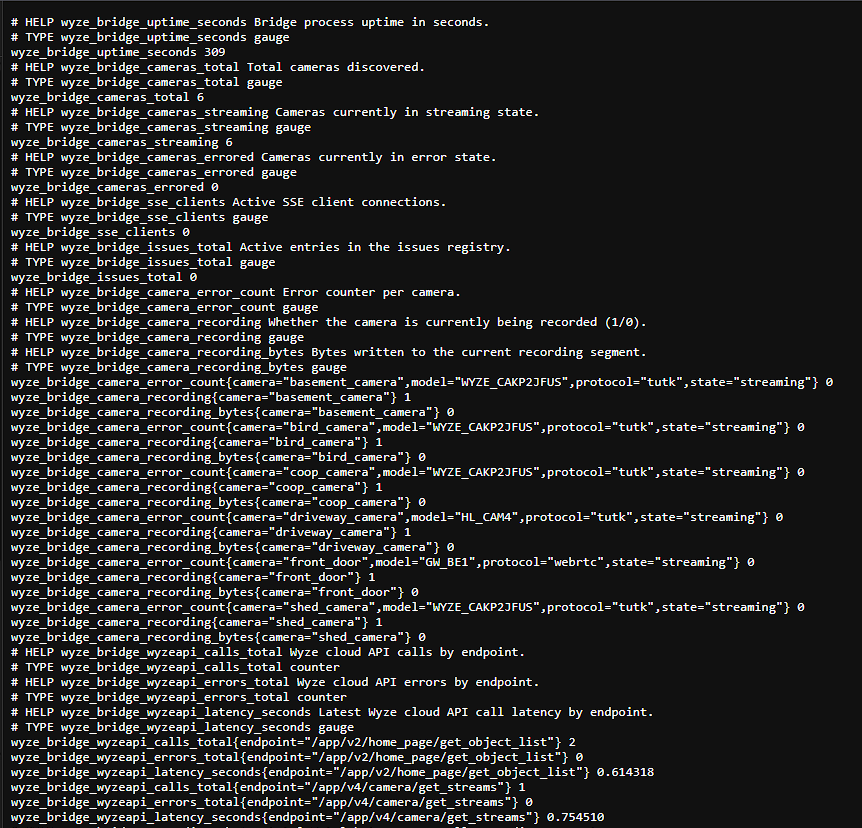

# Docker Wyze Bridge

[](https://github.com/idisposable/docker-wyze-bridge/releases/latest)
[](https://ghcr.io/idisposable/docker-wyze-bridge)
[](https://github.com/IDisposable/docker-wyze-bridge/actions/workflows/docker-image.yml)
[](./docs/user_guide/install_ha.md)

Local WebRTC / RTSP / HLS bridge for Wyze cameras. No modifications, no
special firmware, no cloud dependency for streaming (TUTK + OG cameras
stay entirely on-LAN; doorbell-lineage cameras use Wyze's own WebRTC
signaling but the media still flows directly to you).

Built in **pure Go** on top of [go2rtc](https://github.com/AlexxIT/go2rtc).
No Python, no binary SDKs, no C code beyond the `ffmpeg` used for
snapshot extraction and MP4 recording. Docker image ~65 MB.


> [!IMPORTANT]
> You need a Wyze Developer API ID **and** Key, not just your account
> password. Get them from the [Wyze Developer Console](https://developer-api-console.wyze.com/#/apikey/view).

> [!WARNING]
> Do **not** forward the bridge's ports on your public router/firewall
> or enable DMZ access. The WebUI and RTSP endpoints are designed for
> local use. For remote access, use a VPN (Tailscale, Wireguard, OpenVPN)
> or put a reverse proxy with authentication in front.

> **Upgrading from the Python bridge (mrlt8 v2.x / earlier 3.x)?** See
> [MIGRATION.md](MIGRATION.md) for the env-var rename table, breaking
> changes, and dropped features.

## Screenshots

Click any thumbnail for the full-size image. Tall screenshots are
cropped to the camera-row height — click through to see the
complete page. Metrics are also exposed as JSON at `/api/metrics`.

<table>
  <tr>
    <td align="center" width="50%">
      <a href="DOCS/screenshots/01-All%20Cameras.png"></a>
      <br><sub><b>All Cameras</b></sub>
    </td>
    <td align="center" width="50%">
      <a href="DOCS/screenshots/02-One%20Camera.png"></a>
      <br><sub><b>Single Camera</b></sub>
    </td>
  </tr>
  <tr>
    <td align="center">
      <a href="DOCS/screenshots/03-Metrics%20%281%29.png"></a>
      <br><sub><b>Metrics — top</b></sub>
    </td>
    <td align="center">
      <a href="DOCS/screenshots/04-Metrics%20%282%29.png"></a>
      <br><sub><b>Metrics — bottom</b></sub>
    </td>
  </tr>
  <tr>
    <td align="center" colspan="2">
      <a href="DOCS/screenshots/05-Prometheus.png"></a>
      <br><sub><b>Prometheus export at <code>/metrics.prom</code></b></sub>
    </td>
  </tr>
</table>

## Camera Support

Three streaming paths, picked automatically per camera — you don't
configure the path, the bridge routes based on the model.

- **TUTK** — go2rtc's built-in `wyze://` source. Direct LAN P2P (or
  cloud-relayed P2P if the camera is remote) for most of the fleet.
- **Gwell P2P** — `gwell-proxy` sidecar handles Wyze's newer
  Gwell/IoTVideo LAN-direct UDP protocol. Enabled by default (set
  `GWELL_ENABLED=false` to opt out); the sidecar only actually
  spawns when a Gwell-P2P model is discovered — currently just the
  Window Cam (`GW_WC`), or an OG (`GW_GC1`/`GW_GC2`) explicitly
  flipped back to Gwell via `MODEL_OVERRIDES`. Cameras whose LAN IP
  the Wyze cloud doesn't report can be pinned via
  `GWELL_LAN_IPS=DEVICEID=IP,DEVICEID=IP` (matched against the
  camera's MAC) so gwell-proxy locks LAN-direct instead of relay.
- **WebRTC (KVS)** — go2rtc's native `#format=wyze` handler dials
  Wyze's `wyze-mars-webcsrv.wyzecam.com` signaling server itself and
  speaks AWS-KVS WebRTC. Used by doorbell-lineage hardware that skips
  both TUTK and Gwell P2P.

| Camera | Wyze ID | Path | Status |
| ------ | ------- | ---- | ------ |
| Wyze Cam V1 (HD only) | `WYZEC1` | TUTK | Should work |
| Wyze Cam V2 | `WYZEC1-JZ` | TUTK | Should work |
| Wyze Cam V3 | `WYZE_CAKP2JFUS` | TUTK | Confirmed |
| Wyze Cam V3 Pro (2K) | `HL_CAM3P` | TUTK | Should work |
| Wyze Cam V4 (2K) | `HL_CAM4` | TUTK / WebRTC | Confirmed on FW <4.52; newer FW blocks TUTK, bridge auto-fallbacks to WebRTC (see below) |
| Wyze Cam Floodlight | `WYZE_CAKP2JFUS` | TUTK | Should work |
| Wyze Cam Floodlight V2 (2K) | `HL_CFL2` | TUTK | Should work |
| Wyze Cam Pan | `WYZECP1_JEF` | TUTK | Should work |
| Wyze Cam Pan V2 | `HL_PAN2` | TUTK | Should work |
| Wyze Cam Pan V3 | `HL_PAN3` | TUTK | Mostly working |
| Wyze Cam Pan Pro (2K) | `HL_PANP` | TUTK | Should work |
| Wyze Cam Outdoor | `WVOD1` | TUTK | Should work |
| Wyze Cam Outdoor V2 | `HL_WCO2` | TUTK | Should work |
| Wyze Cam Doorbell V1 | `WYZEDB3` | TUTK | Needs support in go2rtc |
| Wyze Cam Doorbell V2 (2K) | `HL_DB2` | TUTK | Confirmed |
| Wyze Video Doorbell Pro | `GW_BE1` | WebRTC | **Confirmed 2026-04-20** |
| Wyze Video Doorbell Pro 2 | `AN_RDB1` | WebRTC | Expected (same lineage) |
| Wyze Video Doorbell Duo | `GW_DBD` | WebRTC | Expected (same lineage) |
| Wyze Cam OG | `GW_GC1` | WebRTC | Confirmed (route via `is_webrtc=true` overrides `is_gwell` to reach mars-webcsrv) |
| Wyze Cam OG Telephoto 3X | `GW_GC2` | WebRTC | Expected (same lineage as GW_GC1) |
| Wyze Battery Cam Pro | `AN_RSCW` | — | Not supported |
| Wyze Cam Floodlight Pro (2K) | `LD_CFP` | — | Not supported |

"Expected" means the code path is plumbed and equivalent hardware is
known to work, but we don't own a unit to confirm end-to-end. Bug
reports welcome.

### V4 (`HL_CAM4`) on new firmware

Wyze pushed a firmware update in early 2025 that disabled the TUTK
protocol on newer V4 units — cameras that used to work stop
connecting with `IOTC_ER_TIMEOUT` even though the Wyze app still
plays them. The stream is still available via Wyze's WebRTC backend
(same one the doorbells use).

**4.5+ recovers these cameras automatically.** After
`TUTK_FALLBACK_THRESHOLD` (default `5`) consecutive TUTK failures the
bridge promotes the camera to the WebRTC path for the rest of the
process lifetime. No config change needed. Watch `/metrics` for the
`camera/fallback/<name>` issue and the `webrtc (forced)` label on
the camera row.

To pin a camera to WebRTC immediately (skipping the streak), set
`MODEL_OVERRIDES=HL_CAM4:is_webrtc=true` (HA add-on: **Camera Model
Registry → Model Overrides** → `model=HL_CAM4, is_webrtc=true`). To
disable the auto-fallback entirely, set `TUTK_FALLBACK_THRESHOLD=0` —
the chronic-error hint still points at the manual override.

### Cameras whose LAN IP changed (`discovery timeout`)

The Wyze cloud reports each camera's LAN IP, but only as of the last
time the camera phoned home. After a DHCP lease change the cloud can
lag for hours, and go2rtc keeps dialing the old address: the camera
shows `streaming` in the UI while every pull ends in
`wyze: connect failed: discovery timeout`.

**4.6+ checks the LAN itself.** Before a TUTK camera is handed to
go2rtc, and every `LAN_IP_RECHECK` (default `2m`) while it streams,
the bridge asks the LAN which address the camera's MAC is answering
from: first the cloud IP (one ARP round trip, a few milliseconds),
then any address the kernel's neighbor cache or an earlier sweep
already associates with that MAC, and as a last resort an ARP sweep
of the camera's `/24` and the rest of the local subnet. The requests
are addressed to the camera's own MAC rather than broadcast, because
a Wi-Fi camera dozing in power save can sleep through a broadcast but
gets a unicast frame delivered and retried by the access point (and a
sweep addressed to one station costs the rest of the LAN nothing). A
first recheck runs twenty seconds after startup, since a camera or
two usually miss the startup probe, when all of them are asked at
once. The same probe also teaches the NAS's own kernel where the
camera is, which matters: Linux only looks a new address up by
broadcast, so until something did this go2rtc's dial couldn't even
leave the box for a camera that sleeps through broadcasts. The verified
address goes into the stream URL, the dashboard, MQTT and
`/api/cameras` (`cloud_ip` keeps the cloud's value), and shows up as
a `lan_ip` event on `/metrics`. A camera the bridge can't find keeps
whatever address it had, so nothing is ever worse than before.

Requirements: `network_mode: host` (TUTK needs it anyway) and
`CAP_NET_RAW`, which Docker grants by default. Without raw sockets
the bridge falls back to reading the kernel's neighbor cache, which
can trail a moved camera by a minute or so. The startup log says
which engine is active (`LAN IP resolver ready engine=arp`).

To see the resolver at work, open a camera's detail page: the
**Network** box shows the address the cloud reported, when the bridge
last verified the camera and by which route (cloud address, last
known address, neighbor cache, LAN sweep), how many sweeps in a row
missed it, and which engine is running. The same fields are in
`/api/cameras` as `lan_ip_source`, `lan_ip_verified_at` and
`lan_sweep_misses`.

For the odd camera ARP can't reach (on a VLAN the container doesn't sit
on, say) the same box has a **Pinned** field: type the address, click
**Pin**, and the bridge uses it no matter what the cloud or the
resolver say, across restarts, until you **Clear** it. Pins are kept by
MAC in the state file and only make sense for cameras the bridge dials
directly (TUTK); doorbells and OG cameras are refused. REST: `POST
/api/cameras/{name}/pin` with `{"ip":"192.168.4.151"}`, empty to unpin.

| Variable | Default | Description |
| -------- | ------- | ----------- |
| `LAN_IP_RESOLVE` | `true` | Verify TUTK cameras' LAN addresses by MAC before go2rtc dials them |
| `LAN_IP_SWEEP` | `true` | Allow the last-resort ARP sweep (paced, capped at a `/22`, throttled so an absent camera can't flood the LAN) |
| `LAN_IP_RECHECK` | `2m` | How often streaming cameras are re-verified; `0` disables |

### Dashboard

The dashboard follows your OS light/dark setting; the ◐ button in
the header overrides it (remembered per browser). The chips count
cameras, live streams, streams with no video and ignored cameras,
and the filter box narrows the grid by name, model or IP.

### Arranging the dashboard

Click **🔓 Arrange** in the header, drag tiles by the ⠿ handle into
the order you want, then click **🔒 Locked**. A locked grid has no
handles, so a stray touch on a phone can't shuffle it. The order is
saved in the bridge's state file, not the browser, so every device
sees the same grid; new cameras land at the end in name order.

While arranging, the ⟳ button on a tile turns its picture a quarter
turn per click, for cameras mounted sideways or upside down. That's a
view rotation: it applies to the tile and the detail page and is saved
with the layout, but the stream the camera sends (RTSP, HLS, Home
Assistant) is untouched. To flip the stream itself use the camera's
own flip settings (see the detail page).

### Camera controls

The detail page has a **Camera** row for settings that live on the
camera itself and go through the Wyze cloud: flip horizontal, flip
vertical, night vision (auto / on / off) and **⟲ Reboot camera**.
These are the same properties the MQTT `set` topics drive, so a
change made here is mirrored to the camera's MQTT state topic and
Home Assistant stays in step. Wyze doesn't report these values back,
so the buttons are stateless: green means Wyze accepted it, red means
it didn't. Reboot asks first, restarts the camera (the stream drops
for about a minute) and re-registers the go2rtc stream so it dials
the camera fresh when it's back; **Restart Stream** next to it only
re-registers the stream. REST: `POST /api/cameras/{name}/property`
with `{"property":"hor_flip","value":"on"}` (any name from the MQTT
set table), `POST /api/cameras/{name}/reboot`.

### What the badges mean

The green `streaming` badge means go2rtc accepted the stream; it says
nothing about video, because go2rtc only dials a camera when something
pulls the stream and never reports a failed dial. The second badge is
the honest one: `live` means bytes arrived in the last 30 seconds,
`idle` means nobody is pulling (normal), `no video` means something
is pulling but nothing is coming back, or go2rtc reported an error for
that stream — hover for the reason. The dashboard's own players count
as pulling, and the error go2rtc sends a player when a dial fails is
read off on the way through, so a card you're looking at tells the
truth within a minute even when nothing else pulls that camera. If a
camera's connection is up but has gone silent while something is
pulling it (a V3 that drops off Wi-Fi mid-stream leaves go2rtc holding
a dead session, and every new viewer joins it), the bridge restarts
the stream on its own, at most once every two minutes, and sends the
dashboard's players to reconnect; that's what the Restart Stream
button does by hand. The dashboard's
players also start a moment apart instead of all at once, and any
player whose picture stops moving for 20 seconds reconnects by itself
(backing off for a camera that keeps failing), and each tile asks for
a single MSE stream rather than WebRTC and MSE at once. go2rtc's player waits
forever after a failed dial, which is why a card could spin while the
same camera opened instantly on its detail page. A `discovery timeout` on a TUTK
camera also triggers an immediate LAN IP recheck (see above). The
detail page shows when video last flowed and the last error; the
`/metrics` event log records every drop and recovery.

## Quick Start

```bash
docker run -p 5080:5080 -p 8554:8554 -p 8888:8888 -p 8889:8889 -p 8189:8189/udp \
  -e WYZE_EMAIL=you@example.com \
  -e WYZE_PASSWORD=yourpass \
  -e WYZE_API_ID=your-api-id \
  -e WYZE_API_KEY=your-api-key \
  -v "$PWD/config:/config" \
  idisposablegithub365/wyze-bridge:latest
```

Then open `http://localhost:5080` for the WebUI. Keep the `/config`
mount: the state file there holds the Wyze login and everything you
set in the WebUI (ignore list, Settings rules, pinned addresses,
video quality, tile layout), and without it all of that is lost each
time the container is recreated.

> [!TIP]
> **TUTK / older doorbell users:** if streams fail with `discovery
> timeout` and a packet capture shows ICMP `port unreachable` on the
> return path, Docker's bridge NAT is dropping the camera's UDP
> dial-back. Add `--network=host` (or `network_mode: host` in
> compose) — the bridge then binds directly to the host network and
> NAT is out of the way. The HA add-on already runs host-networked
> for the same reason.

## Docker image tags

Published to both Docker Hub (`idisposablegithub365/wyze-bridge`) and
GHCR (`ghcr.io/idisposable/docker-wyze-bridge`). Both registries carry
the same image under the same tags.

| Tag | What it is | When to use |
| --- | ---------- | ----------- |
| `latest` | Newest released stable version. Auto-advanced by CI when a new `v*.*.*` tag is pushed. | Default for most users. |
| `4`, `4.5`, `4.5.0` | Semver-narrowed pins for the same release. `4.5` follows the newest 4.5.x patch, `4` follows the newest 4.x.y. | Pin the compatibility window you want. |
| `main` | HEAD of the `main` branch. **May advance between tagged releases** because CI commits `[skip ci]` version-bumps to the edge add-on config on `main`. The bridge code itself matches `latest`; the extra commits are add-on metadata. | Only if you need something merged to `main` between tags. |
| `edge` | HEAD of the `dev` branch. Bleeding-edge, may be unstable, refreshed by every dev push. Also published as `X.Y.Z-edge.YYYYMMDD.HHMM` per build. | Testing unreleased fixes; HA add-on's "Wyze Bridge (Edge)" pins to this. |
| `sha-<40-char>` | Immutable per-commit pin. | Rollbacks, reproducible deployments. |

## Docker Compose

**Option A — pull the prebuilt image** (recommended):

```yaml
services:
  wyze-bridge:
    image: idisposablegithub365/wyze-bridge:latest
    restart: unless-stopped
    # network_mode: host      # Uncomment for TUTK / doorbell users
                              #  hit by Docker bridge NAT dropping the
                              #  camera's UDP return path. When host
                              #  mode is on, omit the `ports:` block
                              #  below — host networking exposes them.
    ports:
      - 5080:5080            # WebUI + REST API
      - 8554:8554            # RTSP
      - 8888:8888            # HLS
      - 8889:8889            # WebRTC HTTP
      - 8189:8189/udp        # WebRTC ICE
    volumes:
      - ./config:/config                   # state, go2rtc.yaml
      - ./media:/media                     # snapshots + recordings land here
    environment:
      - WYZE_EMAIL=you@example.com
      - WYZE_PASSWORD=yourpass
      - WYZE_API_ID=your-api-id
      - WYZE_API_KEY=your-api-key
      # - BRIDGE_IP=192.168.1.50           # Required for WebRTC in-browser playback
      # - STREAM_AUTH=viewer:secret        # See Authentication section
      # - RECORD_ALL=true
      # - MQTT_HOST=homeassistant.local    # Enables MQTT auto-discovery
```

Then `docker compose pull && docker compose up -d`.

**Option B — build from source**. Clone the repo and use the shipped
[`docker-compose.yml`](docker-compose.yml) — it's already wired to
build the image locally from the current `docker/Dockerfile`:

```bash
git clone https://github.com/IDisposable/docker-wyze-bridge.git
cd docker-wyze-bridge
# Fill in credentials in docker-compose.yml (or a .env file)
docker compose up -d --build
```

Same environment / volumes / ports as Option A, just built from
whatever revision you have checked out. Useful for testing unmerged
branch changes.

**Architectures.** We publish `linux/amd64` and `linux/arm64` only.
32-bit ARM (`linux/arm/v7`, RPi 3 / RPi Zero 2 32-bit) isn't shipped
— the CI build failed on a go2rtc-fetch / base-image incompatibility
and hasn't been re-attempted. A native local build on an armv7 host
may work, but is unsupported.

## Stream URLs

Each camera is available at:

| Protocol | URL |
| -------- | --- |
| RTSP | `rtsp://HOST:8554/<camera_name>` |
| HLS | `http://HOST:8888/<camera_name>` |
| WebRTC (browser) | `http://HOST:5080/camera/<camera_name>` |
| Snapshot (JPEG) | `http://HOST:5080/api/snapshot/<camera_name>` |

Camera names are normalized: lowercase, spaces replaced with underscores
(`Front Door` → `front_door`).

## Home Assistant

[](https://my.home-assistant.io/redirect/supervisor_add_addon_repository/?repository_url=https%3A%2F%2Fgithub.com%2FIDisposable%2Fdocker-wyze-bridge)

Click the badge (on a machine that can reach your HA instance) to
open the add-on store with this repo pre-filled. Then pick a channel:
**Wyze Bridge** (stable, tracks `main`) or **Wyze Bridge (Edge)**
(experimental, tracks `dev`). Setup docs live next to each add-on:
[stable](home_assistant/wyze_bridge/DOCS.md) /
[edge](home_assistant/wyze_bridge_edge/DOCS.md). If you also have
the Mosquitto broker add-on, cameras appear automatically via MQTT
discovery.

Auto-created entities per camera:

- `camera.<mac>` — live stream + snapshot
- `select.<mac>_quality` (HD / SD, saved like the Settings page
  choice and kept in step with it), `switch.<mac>_audio` — runtime
  controls
- `binary_sensor.<mac>_recording` — flips with the record button

Bridge-wide entities:

- `sensor.bridge_cameras` / `sensor.bridge_streaming` / `sensor.bridge_errored` — counts
- `sensor.bridge_uptime` — seconds since start
- `sensor.bridge_recordings_size` — total MP4 bytes
- `sensor.bridge_config_errors` — non-zero = check the `/metrics` page

The add-on's `run.sh` also drops an auto-generated Lovelace dashboard
at `/config/wyze_bridge_dashboard.yaml` at startup — add it as a
dashboard resource in HA and you get a ready-made view with glance
cards for every camera, no manual config.

## Configuration

Everything is controlled by environment variables. See
[MIGRATION.md](MIGRATION.md) for the full reference; the common ones:

| Variable | Required? | Description |
| -------- | --------- | ----------- |
| `WYZE_EMAIL` | yes | Wyze account email |
| `WYZE_PASSWORD` | yes | Wyze account password |
| `WYZE_API_ID` | yes | API ID from Wyze Developer Console |
| `WYZE_API_KEY` | yes | API Key from Wyze Developer Console |
| `WYZE_TOTP_KEY` | optional | TOTP secret for accounts with 2FA enabled |
| `BRIDGE_IP` | for WebRTC | Host IP that browsers reach the bridge at; injected as a WebRTC ICE candidate |
| `MQTT_HOST` | for MQTT | MQTT broker hostname (enables MQTT) |
| `LOG_LEVEL` | no | `trace` / `debug` / `info` / `warn` / `error` (default `info`) |

### Per-Camera Overrides

Uppercase the normalized camera name, then prefix:

```bash
QUALITY_FRONT_DOOR=sd      # hd (default) or sd
AUDIO_BACKYARD=false       # audio off for this camera
RECORD_GARAGE=true         # recording on for just this camera
```

Quality can also be set per camera at runtime: the **Video quality**
table on the Settings page, the HD / SD buttons on a camera's page,
the MQTT `quality` select, or `POST /api/cameras/{name}/quality` with
`{"quality":"sd"}` (`""` goes back to the default). The choice is
saved in the state file by MAC and beats `QUALITY_<CAM>` and
`QUALITY`; changing it restarts that camera's stream once. HD is the
camera's best (1080p on a V3, 2K on the 2K models), SD is 360p at a
much lower bitrate, which helps a camera on weak Wi-Fi. There's one
stream per camera, so the dashboard, Home Assistant, RTSP clients and
recordings all get the same one. Doorbells and Gwell cameras pick
their own and aren't listed.

### Camera Filtering

```bash
FILTER_NAMES=Front Door,Backyard    # Include these cameras only
FILTER_BLOCKS=true                  # Or exclude the listed ones
FILTER_MODELS=WYZECP1_JEF           # By model code (comma-separated)
FILTER_MACS=AA:BB:CC:DD:EE:FF       # By MAC
```

**Ignore list (4.6+).** Every camera card on the dashboard has a 🚫
button. Ignoring a camera drops it from go2rtc, hides it, stops the
reconnect attempts and LAN sweeps for it, and remembers its MAC in
the state file so it stays gone across restarts — handy for cameras
on your Wyze account that aren't on this LAN (a relative's house, a
shared camera). Ignored cameras are listed at the bottom of the
dashboard with a **Restore** button; restoring rediscovers right
away. The env filters above still apply first. REST: `GET
/api/ignored`, `POST /api/cameras/{name}/ignore`, `POST
/api/ignored/{mac}/restore`.

You usually don't have to go looking for them: once two LAN sweeps in
a row have failed to hear a camera's MAC, and it hasn't verified on
the LAN at all since the bridge started, its card grows a "Not on
this LAN?" note with an **Ignore it** button that does the same thing.
The note goes away by itself the moment the camera verifies (or video
flows), so a camera that was just rebooting doesn't get flagged for
long. `/api/cameras` reports the verdict as `lan_absent`.

**Camera rules (Settings page, 4.6+).** For the account-wide version of
the same problem, open **Settings** in the header. The **network
scope** switch has two positions: *any address* (the default, every
camera the cloud lists) and *local subnets only*, which skips cameras
whose address isn't on one of the bridge's own subnets, i.e. what
another house's cameras look like. There's a box for extra CIDRs that
should count as local (a camera VLAN the container doesn't sit on) and
the page shows the subnets it detected. Below that are lists by
nickname (one per line, `*` matches anything, case doesn't matter),
MAC and model, with a block-or-allow switch exactly like
`FILTER_BLOCKS`. Rules are saved in the state file and applied on the
spot: a camera they drop leaves go2rtc and the dashboard like an
ignored one (and comes back as soon as the rules let it), and the
**Excluded by rules** strip at the bottom of the dashboard lists each
one with the reason. The `FILTER_*` env vars still run first, and the
🚫 ignore list still applies on top. A camera the cloud has no address
for can't fail the scope check, so a camera that's merely unplugged
stays on the dashboard, and if the bridge can't tell what's local at
all (no LAN interface and no CIDRs listed) the scope excludes nothing
and the log says so. Note that eero's default LAN is
`192.168.4.0/22`, so if the other household is also on eero its
cameras look local by address and need a name rule or the 🚫 instead.
REST: `GET`/`PUT /api/settings`, `GET /api/excluded`.

### Snapshots

JPEG frames grabbed periodically or on sunrise/sunset events via go2rtc's
frame API.

```bash
SNAPSHOT_INTERVAL=60s                       # periodic capture interval; 0 disables
SNAPSHOT_PATH=/media/snapshots/{cam_name}/%Y-%m-%d
SNAPSHOT_FILE_NAME=%H-%M-%S                 # no extension; .jpg is appended
SNAPSHOT_KEEP=14d                           # retention; 0 = keep forever
SNAPSHOT_CAMERAS=front_door,backyard        # optional allowlist
LATITUDE=37.7749                            # enables sunrise/sunset capture
LONGITUDE=-122.4194
```

### Recording

`ffmpeg -c copy -f segment` per recording-enabled camera, pulling from
our own RTSP endpoint on loopback. Runs only while the camera is
streaming; stops automatically when the camera goes offline.

```bash
RECORD_ALL=true                                 # or RECORD_<CAM>=true
RECORD_PATH=/media/recordings/{cam_name}/%Y/%m/%d
RECORD_FILE_NAME=%H-%M-%S                       # no extension; .mp4 is appended
RECORD_LENGTH=60s                               # segment duration
RECORD_KEEP=7d                                  # retention; 0 = keep forever
```

#### Custom ffmpeg command (`RECORD_CMD` / `RECORD_CMD_<CAM>`)

Replace the built-in ffmpeg argv entirely when you need a different
container, hardware encoder, metadata overlay, or anything else:

```bash
# Global — all recording-enabled cameras use this
RECORD_CMD=ffmpeg -hide_banner -rtsp_transport tcp -i {rtsp_url} -c:v h264_nvenc -preset p6 -b:v 4M -f segment -segment_time {segment_sec} -strftime 1 {output_stem}.webm

# Or per-camera — this wins over the global for one camera
RECORD_CMD_FRONT_DOOR=sh -c 'ffmpeg -i {rtsp_url} -c copy {output} | tee /mnt/archive/front_door.mp4'
```

Supported tokens:

| Token | Value |
| --- | --- |
| `{cam_name}` / `{CAM_NAME}` | Normalized camera name (lower/upper) |
| `{rtsp_url}` | `rtsp://127.0.0.1:8554/<cam_name>` — our loopback RTSP |
| `{rtsp_host}` / `{rtsp_port}` | Host + port separately, for custom URL schemes |
| `{output}` | Expanded `RECORD_PATH/RECORD_FILE_NAME.mp4` |
| `{output_dir}` / `{output_stem}` | Split of the above — stem is everything before `.mp4` so you can write a different extension |
| `{segment_sec}` | `RECORD_LENGTH` in integer seconds |
| `{quality}` | `hd` or `sd` per camera |

**Invocation semantics:**

- The template is tokenized respecting double/single quotes (no shell
  by default, no variable expansion, no pipes). The program in the
  first position is `exec`'d directly.
- For pipes / shell features, prefix with `sh -c "..."` — you're
  opting in explicitly.
- Unknown tokens (like `{typo_here}`) fail parsing at the first spawn
  attempt; the bridge falls back to the built-in default argv for that
  camera and raises a config error visible on `/metrics` and
  `/api/health`. Recording for other cameras is unaffected.

### Authentication

- `BRIDGE_AUTH=true` + `BRIDGE_USERNAME` + `BRIDGE_PASSWORD` — gates the
  WebUI + REST API.
- `STREAM_AUTH=viewer:secret` — RTSP / HLS / WebRTC streams require
  these credentials. Per-camera auth is not supported in this rewrite.

## Ports

| Port | Purpose |
| ---- | ------- |
| 5080 | Bridge WebUI + REST API |
| 1984 | go2rtc native UI (optional; useful for probing/debugging) |
| 8554 | RTSP |
| 8888 | HLS |
| 8889 | WebRTC HTTP |
| 8189/udp | WebRTC ICE |

## Observability

The bridge exposes several operational endpoints at `http://HOST:5080`:

| Path | Purpose |
| ---- | ------- |
| `/metrics` | Human-readable HTML dashboard: issues panel, bridge summary, per-camera table, Wyze cloud API call stats, storage footprint, recent events log. Auto-refreshes every 10 seconds. |
| `/metrics.prom` | Prometheus-format exposition. Gauges + counters under the `wyze_bridge_` prefix with labels for camera, protocol, endpoint. Unauthenticated by default so Grafana / VictoriaMetrics scrapers work without any extra config. |
| `/api/metrics` | Same snapshot as `/metrics` but as JSON — convenient for scripting or piping into other tooling. |
| `/api/health` | Compact health check: `{status, version, uptime, config_errors, issues}`. `status` flips to `"degraded"` whenever the issues list is non-empty, which maps cleanly to a HA `binary_sensor`. |
| `/dashboard.yaml` | Auto-generated Home Assistant Lovelace dashboard referencing the MQTT discovery entities the bridge publishes — one glance card per camera with snapshot, recording indicator, and audio/quality controls. See [Home Assistant](#home-assistant) below. |

### Recording controls

Every camera card in the WebUI (and the single-camera page) has a
record pulse button. Clicking starts a per-camera ffmpeg segment
writer pulling from loopback RTSP; clicking again stops it. The same
toggle is available over:

- MQTT: `<topic>/<cam>/recording` (ON/OFF, retained). HA discovery
  publishes a `binary_sensor` by default.
- REST: `POST /api/cameras/<name>/record` with body
  `{"action":"start"|"stop"}` (empty body = start). Returns the
  resulting state, so a client can render from the authoritative
  answer rather than optimistically.

Whatever toggles recording fires an SSE `recording_state` event, so
all open browser tabs + the metrics page update live.

### Issues registry — what does `config_errors > 0` mean?

When the bridge hits a soft failure that an operator needs to know
about, the affected subsystem posts an entry to a process-wide
**issues registry** (keyed for deduplication) instead of silently
warning to the log. The registry feeds three surfaces:

| Surface | What you see |
| ------- | ------------ |
| `/metrics` HTML | A red **Issues** panel at the top of the page lists every open entry: severity, scope, camera (if camera-specific), one-line message, longer detail, and the offending raw value where useful. |
| `/api/health` JSON | `config_errors` is the open issue count; `issues` is the full list; `status` flips to `"degraded"` when non-empty. Suitable for a HA `rest` sensor or a uptime monitor. |
| HA MQTT discovery | `sensor.wyze_bridge_config_errors` exposes the count for HA dashboards/automations. Auto-published when MQTT is configured. |

Current categories that report:

- **`auth`** — Wyze API login or token refresh failed (bad credentials, MFA without a configured `WYZE_TOTP_KEY`, Wyze cloud down). Cleared automatically when the next attempt succeeds.
- **`config`** — invalid `RECORD_PATH` / `RECORD_FILE_NAME` template (missing strftime tokens), malformed `RECORD_CMD` override, etc.
- **`record_cmd/<cam>`** — a per-camera `RECORD_CMD` template failed to parse; bridge fell back to the built-in argv.
- **`camera/chronic/<cam>`** — a camera has failed to connect ≥10 consecutive times (stuck in error state behind a 5-minute backoff). Cleared when that camera next reaches `streaming`.

Each entry includes enough context to act: the camera name, the
specific setting at fault, and (where available) a hint about what
to change. Always start at `/metrics` — it groups everything in one
view.

## FAQ

**How does this work?**
For TUTK cameras, go2rtc speaks Wyze's P2P protocol directly (no SDK).
For OG cameras, a small `gwell-proxy` sidecar handles the Gwell/IoTVideo
handshake. For doorbell-lineage cameras (Doorbell Pro, Doorbell Duo),
go2rtc's built-in Wyze WebRTC handler calls our internal shim for the
KVS signaling URL and dials Wyze's server itself. The bridge
orchestrates auth, discovery, MQTT, and the WebUI.

**Does it use internet bandwidth when streaming?**
For TUTK and Gwell cameras on the same LAN: effectively zero — media
flows directly between the camera and the bridge over UDP. For WebRTC
cameras (Doorbell Pro / Duo): the signaling goes through Wyze's cloud,
and media may route through Wyze's AWS TURN servers if the direct path
can't be negotiated.

**Can this work offline?**
Streaming alone can survive without internet for TUTK/Gwell cameras
already paired, but tokens and some commands eventually need the cloud.
WebRTC cameras need the internet every session to fetch the signaling
URL from Wyze.

**Why isn't `GW_BE1` / `GW_DBD` "supported" on upstream mrlt8?**
Upstream is TUTK-only; doorbell-lineage cameras don't expose TUTK at
all. We handle them via Wyze's cloud WebRTC path, which upstream
doesn't implement.

**What about Battery Cam Pro?**
Not yet. Uses a different protocol than any of the three we handle.

## Architecture

```goat
Docker Container
├── wyze-bridge (Go binary, port 5080)
│   ├── Wyze API Client        — auth, camera discovery, get_streams
│   ├── go2rtc Manager         — subprocess, skeletal YAML, AddStream API
│   ├── Camera Manager         — state machines, reconnection, routing
│   ├── MQTT Client            — HA discovery, commands, state
│   ├── WebUI Server           — REST API, SSE, embedded UI, WebRTC shim
│   ├── Snapshot Manager       — interval, sunrise/sunset, pruning
│   └── Recording Manager      — ffmpeg per camera, segment pruning
├── go2rtc (managed sidecar, ports 1984 / 8554 / 8888 / 8889 / 8189)
│   ├── wyze://   source       — TUTK P2P (built in)
│   ├── rtsp:     source       — receives publish from gwell-proxy
│   └── webrtc:   source       — native Wyze KVS (via our shim)
└── gwell-proxy (only spawned for OG cameras)
    └── Gwell P2P → ffmpeg → RTSP PUBLISH to loopback go2rtc
```

## Development

```bash
go test ./...                     # run tests
go build -o wyze-bridge ./cmd/wyze-bridge
docker compose up --build         # Docker build + run
./cycle.sh                        # local dev cycle with .env.dev
```

See [DEVELOPER.md](DEVELOPER.md) for local dev / devcontainer setup.

## Attribution

This fork builds on work from several upstream projects:

- `idisposable/docker-wyze-bridge`
- `akeslo/docker-wyze-bridge`
- `kroo/wyzecam`
- `AlexxIT/go2rtc`
- `wlatic/hacky-wyze-gwell`
- `idisposable/docker-wyze-bridge`

The `go2rtc` sidecar uses [github.com/AlexxIT/go2rtc](https://github.com/AlexxIT/go2rtc), which is licensed under MIT.
The `gwell` sidecar uses a vendored copy of the Go protocol packages from [github.com/wlatic/hacky-wyze-gwell](https://github.com/wlatic/hacky-wyze-gwell), which is licensed under MIT.

 See [THIRD_PARTY_NOTICES.md](./THIRD_PARTY_NOTICES.md).

## License

[GNU AGPL v3](LICENSE)
